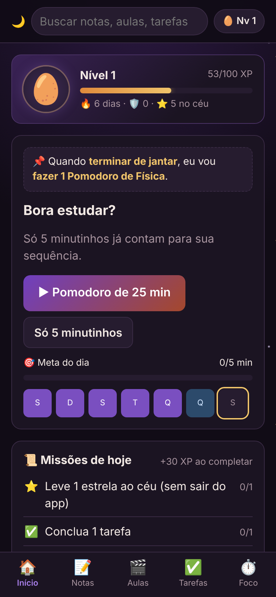
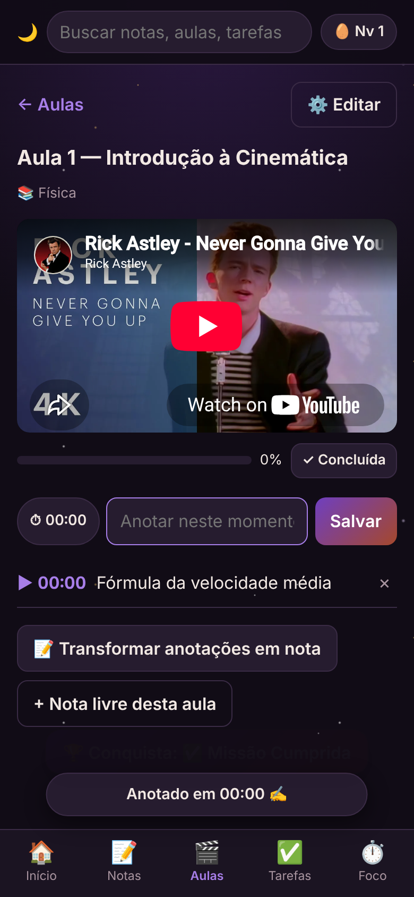
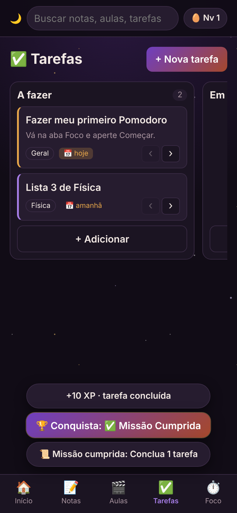
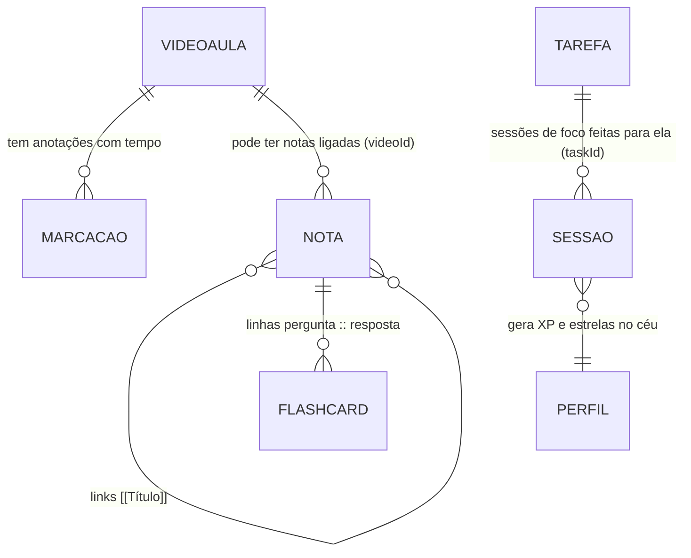
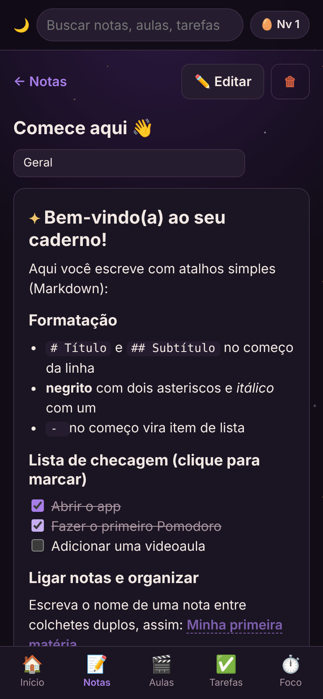
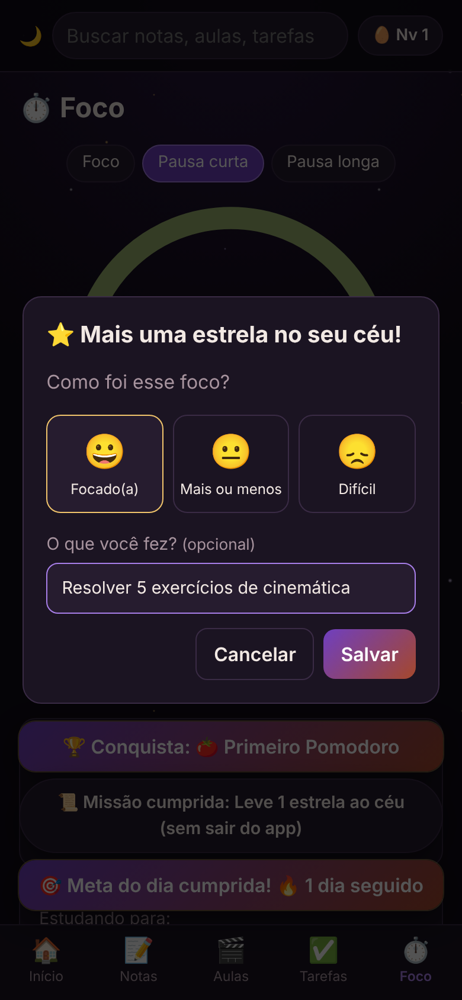
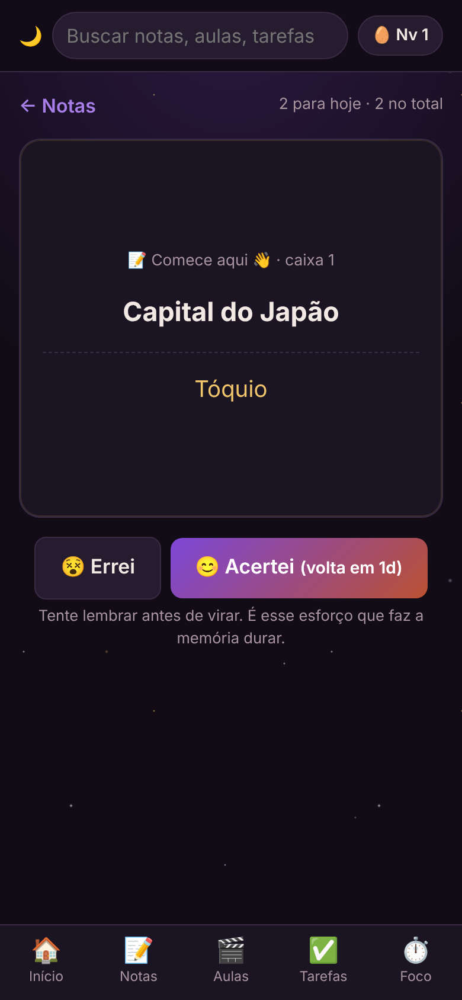

# 🌙 EstudoQuest

Um app de estudos que junta num só lugar **caderno de notas**, **videoaulas com progresso**, **quadro de tarefas** e **timer Pomodoro**, com uma camada de jogo opcional (XP, níveis, conquistas e uma coleção que cresce).

<p>
    
</p>

---

## 1. Como abrir o app

**Opção A: no computador, para testar (1 minuto)**
1. Instale o [Python](https://www.python.org/downloads/) se ainda não tiver (ele já vem no Mac e no Linux).
2. Abra o terminal dentro da pasta `estudoquest` e rode:
   ```
   python3 -m http.server 8000
   ```
3. Acesse **http://localhost:8000** no navegador.

> Por que não dá só pra dar dois cliques no `index.html`? Dá, e notas, tarefas e timer funcionam. Mas o **YouTube se recusa a tocar** em páginas abertas direto do arquivo, então use a opção A ou B.

**Opção B: no celular, de graça, com GitHub Pages (recomendado)**
1. Crie uma conta no [GitHub](https://github.com) e um repositório novo (ex.: `estudoquest`).
2. Envie os arquivos desta pasta (botão *Add file → Upload files*).
3. Vá em *Settings → Pages*, escolha a branch `main` e salve.
4. Em ~1 minuto o app estará em `https://SEU-USUARIO.github.io/estudoquest/`.
5. No celular, abra esse link e use **"Adicionar à tela inicial"** (Android: menu ⋮; iPhone: botão Compartilhar). Ele vira um ícone igual a um app e abre até sem internet.

---

## 2. Decisões técnicas, explicadas sem jargão

### Plataforma: **app web instalável (PWA)**
É um site que se instala no celular como app. Escolhi isso porque funciona no **celular e no computador com o mesmo código**, é **publicado de graça** (GitHub Pages) e não precisa passar por loja de apps.

### Stack: **HTML + CSS + JavaScript puro, sem framework**
| Arquivo | O que faz |
|---|---|
| `index.html` | O "esqueleto": barra do topo, menu de baixo e o espaço onde as telas aparecem |
| `style.css` | Cores e aparência. As cores ficam no topo do arquivo, fáceis de trocar |
| `app.js` | Toda a lógica, dividida em 7 seções numeradas |
| `sw.js` + `manifest.webmanifest` + `icon.svg` | O que faz o app ser instalável e abrir offline |

**Por que sem React, Vue etc.?** Para você conseguir manter sozinho: não há nada para instalar, compilar ou atualizar. Você edita um arquivo, recarrega a página e vê a mudança.

### Onde os dados ficam: **no próprio aparelho (localStorage)**
O navegador tem um "cofrinho" onde o app guarda tudo. Vantagens: grátis, instantâneo, funciona offline e não precisa de conta.
**Cuidado:** os dados ficam só naquele aparelho e naquele navegador. Por isso existe **Perfil → Exportar dados** (gera um arquivo `.json` de backup) e **Importar** (para restaurar ou levar para outro aparelho). Sincronização automática fica para a v2.

### Vídeos: **YouTube (player oficial) ou link direto de .mp4**
O player oficial do YouTube permite ler "em que segundo o vídeo está", e é isso que faz o progresso e as anotações com tempo funcionarem. Não precisa de chave nem conta.

---

## 3. O que está na v1 (MVP) e o que fica para depois

### ✅ v1: o que já funciona
- **Notas**: escrever em Markdown simples, ver formatado, **links entre notas** com `[[Título]]` (cria a nota se não existir), seção "Mencionada em" (backlinks), **pastas** (matéria) e **#tags** clicáveis, listas de checagem clicáveis e salvamento automático.
- **Videoaulas**: adicionar por link, organizar por curso, **retomar de onde parou**, barra de progresso por aula e por curso, conclusão automática aos 90%, **anotações no segundo exato** (o vídeo pausa quando você começa a digitar), clicar no tempo para voltar ao trecho e **transformar as anotações em uma nota** cujos `[mm:ss]` continuam clicáveis.
- **Tarefas**: quadro com colunas *A fazer / Em andamento / Concluído*, prazo com aviso de "hoje"/"atrasada", matéria, arrastar e soltar no computador e botões ◀ ▶ no celular.
- **Foco**: Pomodoro (foco, pausa curta, pausa longa), botão **"Só 5 minutinhos"** para vencer a preguiça de começar, vincular a sessão a uma tarefa, som e notificação ao terminar. O timer continua certo mesmo se você trocar de tela.
- **Busca única** no topo: procura em notas, aulas (inclusive nas anotações com tempo) e tarefas.
- **Gamificação (pode ser desligada no Perfil)**: XP, níveis, sequência de dias 🔥, 18 conquistas e uma coleção de 13 itens.
- **Hábito e foco (v1.2)**: veja a seção [Mecânicas para criar o hábito](#-mecânicas-para-criar-o-hábito-v12).
- **Tema "noite de outono"**: sempre escuro, roxo ametista, abóbora e dourado, com céu estrelado (feito só com CSS, sem imagens pesadas). Funciona offline e tem backup em arquivo.

### 🔜 v2: próximos passos sugeridos (em ordem de valor)
1. **Sincronizar entre aparelhos** (ex.: [Supabase](https://supabase.com) ou Firebase no plano grátis), que substitui o backup manual.
2. **Lembrete diário no horário do seu plano**, mesmo com o app fechado. Precisa de um serviço de notificações; dá pra começar grátis com o [ntfy](https://ntfy.sh).
3. **Revisão semanal** no domingo: resumo da semana, melhores horários (a partir das avaliações 😀😐😞) e meta da próxima semana.
4. **Estudo em grupo** estilo Focusmate/YPT: ver amigos focando ao mesmo tempo. Precisa de servidor.
5. **Editor por blocos estilo Notion** (arrastar blocos, inserir imagens).
6. **Lembretes de prazo** por notificação e **calendário** das tarefas.
7. Renomear uma nota atualizando os `[[links]]` nas outras automaticamente.
8. Coleção com imagens próprias em vez de emojis, constelações com nome no céu e temas desbloqueáveis.

---

## 4. Estrutura de dados

Tudo fica num único objeto (`state`) salvo como texto no navegador. São quatro "tipos" principais, mais o perfil:

```
Nota          { id, title, folder, body, videoId?, createdAt, updatedAt }
Videoaula     { id, title, course, url, kind: 'youtube'|'file', ytId,
                position, duration, watched, done, lastOpened,
                marks: [ { id, t (segundos), text, createdAt } ] }
Tarefa        { id, title, description, due (AAAA-MM-DD), tag, column,
                completedAt }
SessãoDeFoco  { id, minutes, endedAt, taskId?, intention, rating, note, star }
Flashcard     { id, noteId, q, a, box (1–6), due (AAAA-MM-DD), seen }
Distração     { id, text, createdAt }           (o "estacionamento" 💭)
Perfil        { xp, gamification, achievements, shields, frozen[],
                quests (missões do dia), planWhen, planWhat }
```

**Como se relacionam:**



- Uma **nota** pode apontar para uma **videoaula** (`videoId`). Aí os `[12:34]` dentro dela viram links que abrem o vídeo naquele segundo.
- As **notas se ligam entre si** pelo texto `[[Título]]`, sem tabela extra. O app procura essas menções para montar o "Mencionada em".
- **Pasta** (nota), **curso** (vídeo) e **matéria** (tarefa) são campos de texto livre que se sugerem entre si. Assim "Física" aparece igual nos três.
- Uma **sessão de foco** pode registrar para qual **tarefa** você estava estudando.
- Os **flashcards** saem das notas: o app lê as linhas `pergunta :: resposta` e guarda só o progresso de cada uma (caixa e próxima data).
- **Sequência, céu e missões** são calculados a partir das sessões. Só os escudos usados (`frozen`) e as missões sorteadas do dia são guardados.
- O **XP** não é guardado por item: o perfil acumula pontos, e o nível e a coleção são *calculados* a partir do total.

---

## 5. Telas e fluxos

Navegação: **menu fixo embaixo** (Início · Notas · Aulas · Tarefas · Foco), **busca no topo** e o **perfil** (nível/configurações) no canto superior direito. O botão "voltar" do celular funciona normalmente.

### 📝 Anotar
```
Notas ─► [+ Nova nota] ─► digita título, pasta e texto (salva sozinho)
                               │
                               ├─ escreve [[Outra nota]] ─► clica ─► abre/cria a nota
                               ├─ escreve #prova ─► clica ─► busca tudo com #prova
                               └─ [👁 Visualizar] ─► vê formatado e marca as [ ] caixinhas
Lista de notas: filtrar por 📁 pasta e por #tag
```
 

### 🎬 Assistir e acompanhar videoaulas
```
Aulas ─► [+ Adicionar aula] ─► cola link do YouTube + curso
  │
  └─► abre a aula ─► vídeo começa de onde você parou
         │
         ├─ toca no campo "Anotar neste momento" ─► vídeo PAUSA e guarda o segundo
         │     └─ digita e Enter ─► anotação [mm:ss] aparece na lista
         ├─ clica em ▶ 12:34 ─► vídeo pula para aquele trecho
         ├─ passou de 90% ─► ✓ concluída (+20 XP)
         └─ [📝 Transformar anotações em nota] ─► vira nota com links de tempo
```


### ✅ Gerenciar tarefas
```
Tarefas ─► [+ Nova tarefa] ─► título, prazo, matéria, coluna
   │
   ├─ celular: botões ◀ ▶ movem entre colunas
   ├─ computador: arrastar e soltar
   ├─ chegou em "Concluído" ─► +10 XP
   └─ toque no cartão ─► editar ou excluir
Cartões com prazo hoje ficam laranja e os atrasados vermelhos. As próximas aparecem no Início.
```


### ⏱️ Foco e 🏠 Início
O **Início** foi pensado para quem tem dificuldade de começar: o botão principal já inicia um Pomodoro e o **"Só 5 minutinhos"** reduz a barreira. A **pausa** convida a dar uma olhadinha no celular, então o doomscroll vira recompensa em vez de fuga.

 

---

## 🌟 Mecânicas para criar o hábito (v1.2)

Cada uma foi inspirada num app que funciona para muita gente e adaptada para estudo:

| Inspiração | Mecânica no EstudoQuest | Por que ajuda |
|---|---|---|
| **Forest** | ⭐ **Modo estrela**: durante o Pomodoro uma estrela cresce (✧ → ✦ → ⭐ → 🌟). Se você sair do app por mais de 10 s, ela cai 💫. As estrelas que chegam ao fim formam o **seu céu** no Perfil, e sessões longas viram estrelas maiores. A tela fica acesa sozinha. | Transforma "não pegar o celular" num objetivo visível. A sessão continua valendo mesmo se a estrela cair: o app não te pune, só deixa de te dar o bônus. |
| **Duolingo** | 🎯 **Meta mínima do dia** (padrão: 5 min). 🔥 Sequência de dias. 🛡️ **Escudos**: a cada 5 dias seguidos você ganha um (até 2), e ele salva sua sequência se você perder um dia. | Hábito é sobre não falhar, não sobre quantidade. O escudo evita o "quebrei a sequência, desisto". |
| **Duolingo / Habitica** | 📜 **3 missões diárias** sorteadas (1 de foco + 2 variadas). Completar as três dá +30 XP. | Você já abre o app sabendo qual é o próximo passo. |
| **Calendário do GitHub** | 📅 **Calendário de constância** (14 semanas) no Perfil e **semana** no Início. | Ver a corrente crescer dá vontade de não quebrá-la. |
| **Focusmate / Session** | ✍️ **Intenção** antes ("Nesta sessão eu vou…") e **avaliação** depois ("Como foi? 😀😐😞"). | Uma meta clara e pequena por sessão. Com o tempo, você descobre seus melhores horários. |
| **Técnicas para TDAH** | 🧘 **Modo imersão**: durante o foco o menu some, ficando só o timer, a intenção e a estrela. 💭 **Estacionamento de distrações**: anota a distração em 2 s e volta. Na pausa, cada item vira tarefa ou é descartado. | Adia a distração em vez de lutar contra ela. Ótimo contra o impulso do doomscroll. |
| **Anki** | 🃏 **Flashcards com repetição espaçada**: qualquer linha `pergunta :: resposta` numa nota vira cartão. Acertou, ele volta em 1, 2, 4, 8, 16, 32 dias; errou, volta para o fim da fila de hoje. | Revisar pouco e sempre fixa a matéria para a prova. |
| **"Quando… então…"** | 📌 **Plano** fixo no Início: "Quando eu terminar de jantar, eu vou fazer 1 Pomodoro de Física". | Ligar o estudo a algo que você já faz é o jeito mais confiável de começar sem força de vontade. |

   

**Dicas fora do app que fazem diferença:**
- Ative o **Modo Foco** do celular durante o Pomodoro (Android: Bem-estar digital; iPhone: Ajustes → Foco). O app não consegue bloquear outros apps sozinho.
- Crie um **alarme** no horário do seu plano com o nome "📚 EstudoQuest".
- Coloque o ícone do app na **primeira tela** do celular, no lugar de uma rede social.

---

## 6. Como personalizar (procure por `✏️ PERSONALIZE` no código)

| Quero mudar… | Onde |
|---|---|
| Quanto XP cada ação dá | `app.js` → `CONFIG.xp` |
| Velocidade de subir de nível | `app.js` → função `levelInfo` (números 100 e 50) |
| Itens da coleção (seus personagens favoritos!) | `app.js` → `CONFIG.collection` |
| Conquistas | `app.js` → lista `ACHIEVEMENTS` |
| Colunas do quadro (ex.: adicionar "Revisar") | `app.js` → `CONFIG.columns` |
| % para considerar a aula assistida | `app.js` → `CONFIG.videoDoneAt` |
| Tempos padrão do Pomodoro | tela Perfil, ou `defaultState()` → `settings` |
| Cores | `style.css` → topo (`--accent` roxo, `--accent2` abóbora, `--gold` estrelas, `--btn-from`/`--btn-to` botões) |
| Quantidade/brilho das estrelas | `style.css` → `body::before` e `body::after` |
| Frases motivacionais | `app.js` → `viewHome` e `viewFocus` |
| Missões diárias | `app.js` → lista `QUESTS` |
| Escudos (a cada quantos dias, máximo) | `app.js` → `CONFIG.shieldEvery` e `CONFIG.maxShields` |
| Tempo fora do app antes de a estrela cair | `app.js` → `CONFIG.starGraceSeconds` |
| Intervalos dos flashcards | `app.js` → `NEXT_DAYS` |
| Meta diária e Modo estrela | tela Perfil (ou Foco, para o Modo estrela) |

**Dica para editar com segurança:** antes de mexer, exporte um backup. Se a tela ficar em branco depois de uma mudança, aperte `F12` no navegador e abra a aba **Console**: ela mostra a linha do erro.

### ⚡ Otimizações (v1.1)
- O timer só "acorda" enquanto está rodando, uma vez por segundo, e não redesenha a tela com o app minimizado. Gasta menos bateria.
- O app abre na hora usando a cópia salva no aparelho e baixa a versão nova por trás.
- Enquanto o vídeo toca, o progresso só é salvo quando muda, e não a cada 2 segundos mesmo pausado.
- **Correção:** o texto digitado logo antes de fechar o app era perdido. Agora ele é gravado ao minimizar ou fechar.
- A barra do topo não usa mais efeito de desfoque, que deixava a rolagem pesada em celulares simples.
- Conexão com o YouTube aberta antes de precisar, no máximo 3 avisos na tela e listas de notas e links mais rápidas.

### Limitações conhecidas da v1
- Os dados ficam só no aparelho em que você usa o app. Faça backup.
- O progresso do vídeo conta o ponto mais longe que você alcançou, então pular para o final conta como assistido.
- No iPhone, as notificações do timer só funcionam com o app instalado na tela inicial (iOS 16.4+). O som toca normalmente com o app aberto.
- **Modo estrela:** o app só sabe se a tela dele está visível, não o que você faz no celular. Por isso a tela fica acesa durante o foco: se ela apagasse, contaria como "saiu do app". No computador, trocar de aba também derruba a estrela; se você estuda por um PDF em outra aba, desligue o Modo estrela.
- Os lembretes ainda não chegam com o app fechado (veja a v2). Por enquanto use um alarme do celular.
- A busca do título automático do YouTube pode falhar em algumas redes. Nesse caso, edite o título na aula (⚙️ Editar).
