# 🌙 EstudoQuest

Um app de estudos que junta num só lugar **caderno de notas**, **videoaulas com progresso**, **quadro de tarefas** e **timer Pomodoro**, com uma camada de jogo opcional (XP, níveis, conquistas e uma coleção que cresce).

<p>
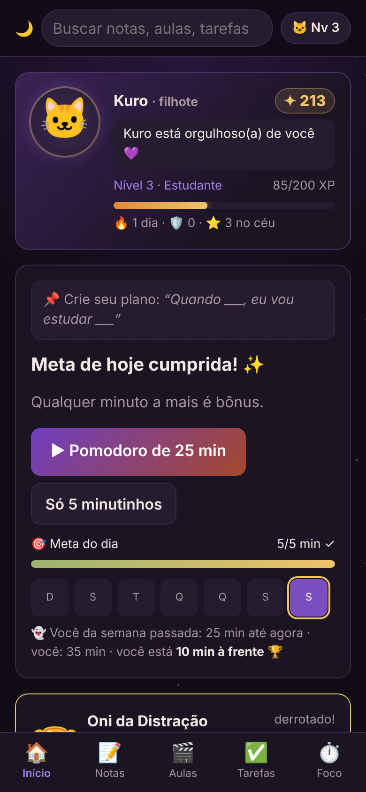 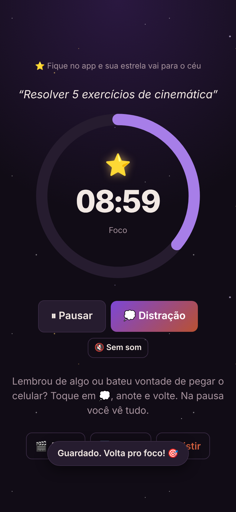 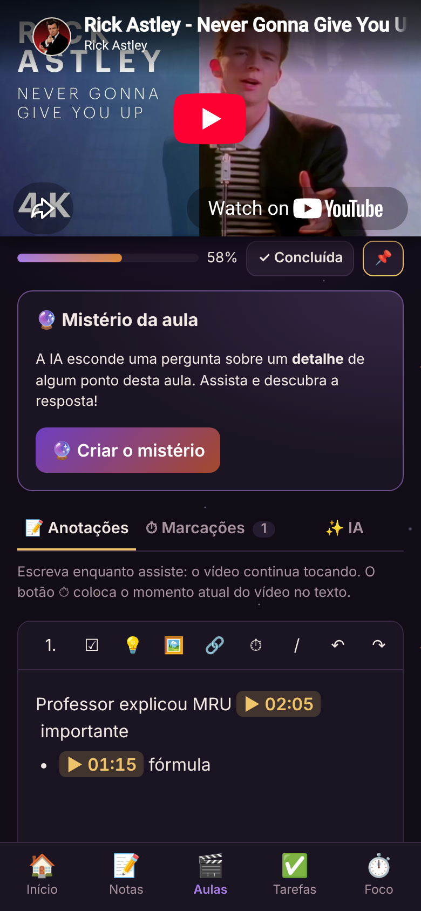  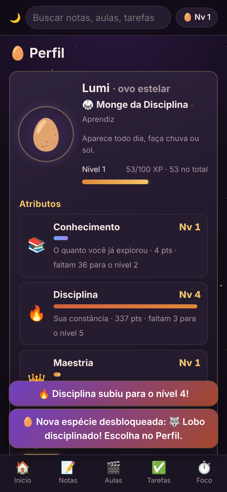
</p>

---

## 1. Como abrir o app

**Opção A: no computador, para testar (1 minuto)**
1. Instale o [Python](https://www.python.org/downloads/) se ainda não tiver (ele já vem no Mac e no Linux).
2. Abra o terminal dentro da pasta `estudoquest` e rode:
   ```
   python3 -m http.server 8000
   ```
3. Acesse **http://localhost:8000** no navegador.

> Por que não dá só pra dar dois cliques no `index.html`? Dá, e notas, tarefas e timer funcionam. Mas o **YouTube se recusa a tocar** em páginas abertas direto do arquivo, então use a opção A ou B.

**Opção B: no celular, de graça, com GitHub Pages (recomendado)**
1. Crie uma conta no [GitHub](https://github.com) e um repositório novo (ex.: `estudoquest`).
2. Envie os arquivos desta pasta (botão *Add file → Upload files*).
3. Vá em *Settings → Pages*, escolha a branch `main` e salve.
4. Em ~1 minuto o app estará em `https://SEU-USUARIO.github.io/estudoquest/`.
5. No celular, abra esse link e use **"Adicionar à tela inicial"** (Android: menu ⋮; iPhone: botão Compartilhar). Ele vira um ícone igual a um app e abre até sem internet.

---

## 2. Decisões técnicas, explicadas sem jargão

### Plataforma: **app web instalável (PWA)**
É um site que se instala no celular como app. Escolhi isso porque funciona no **celular e no computador com o mesmo código**, é **publicado de graça** (GitHub Pages) e não precisa passar por loja de apps.

### Stack: **HTML + CSS + JavaScript puro, sem framework**
| Arquivo | O que faz |
|---|---|
| `index.html` | O "esqueleto": barra do topo, menu de baixo e o espaço onde as telas aparecem |
| `style.css` | Cores e aparência. As cores ficam no topo do arquivo, fáceis de trocar |
| `app.js` | Toda a lógica, dividida em 7 seções numeradas |
| `editor.js` | O editor de notas estilo Notion (barra de formatação, menu "/", links, imagens) |
| `ai.js` | O assistente de IA (Gemini, plano grátis) |
| `skills.js` | Árvores de conhecimento: conceitos por matéria, estágios Descoberto → Praticado → Dominado |
| `character.js` | Ficha do personagem: atributos (Conhecimento, Disciplina, Maestria), classe e personalização |
| `lab.js` | Laboratório de experimentos: casos práticos criados pela IA, com correção construtiva |
| `subjects.js` | Matérias e cursos: renomear em todo o app, minutos estudados por matéria |
| `discovery.js` | Mistério da aula (a IA esconde uma pergunta num trecho), Crônica de Lumi e relíquias |
| `campaign.js` | Modo campanha: capítulos, checkpoints, missões e desafio final por matéria |
| `battle.js` | Batalhas contra o chefe (perguntas) e equipamento estilo Diablo |
| `game.js` | Mascote, pó de estrela e Desejos, chefe da semana, rival, sons de foco, provas, lembrete no calendário |
| `sw.js` + `manifest.webmanifest` + `icon.svg` | O que faz o app ser instalável e abrir offline |

**Por que sem React, Vue etc.?** Para você conseguir manter sozinho: não há nada para instalar, compilar ou atualizar. Você edita um arquivo, recarrega a página e vê a mudança.

### Onde os dados ficam: **no próprio aparelho (localStorage)**
O navegador tem um "cofrinho" onde o app guarda tudo. Vantagens: grátis, instantâneo, funciona offline e não precisa de conta.
As **imagens** das notas ficam num armazenamento maior do navegador (IndexedDB), já reduzidas para ocupar pouco espaço (um print vira uns 100–300 KB).
**Cuidado:** os dados ficam só naquele aparelho e naquele navegador. Por isso existe **Perfil → Exportar dados** (gera um arquivo `.json` de backup) e **Importar** (para restaurar ou levar para outro aparelho). Sincronização automática fica para a v2.

### Vídeos: **YouTube (player oficial) ou link direto de .mp4**
O player oficial do YouTube permite ler "em que segundo o vídeo está", e é isso que faz o progresso e as anotações com tempo funcionarem. Não precisa de chave nem conta.

---

## 3. O que está na v1 (MVP) e o que fica para depois

### ✅ v1: o que já funciona
- **Notas (v1.3, estilo Notion)**: veja a seção [Editor de notas, aulas e IA](#-editor-de-notas-aulas-e-ia-v13). Sem Markdown: barra de formatação, menu `/`, links `[[`, prints, pastas, #tags, "Mencionada em" e salvamento automático.
- **Videoaulas**: adicionar por link, organizar por curso, **retomar de onde parou**, barra de progresso por aula e por curso, conclusão automática aos 90%, **anotações livres enquanto o vídeo toca** (com tempos clicáveis) e **marcações rápidas** de momentos.
- **Tarefas**: quadro com colunas *A fazer / Em andamento / Concluído*, prazo com aviso de "hoje"/"atrasada", matéria, arrastar e soltar no computador e botões ◀ ▶ no celular.
- **Foco**: Pomodoro (foco, pausa curta, pausa longa), botão **"Só 5 minutinhos"** para vencer a preguiça de começar, vincular a sessão a uma tarefa, som e notificação ao terminar. O timer continua certo mesmo se você trocar de tela.
- **Busca única** no topo: procura em notas, aulas (inclusive nas anotações com tempo) e tarefas.
- **Gamificação (pode ser desligada no Perfil)**: XP, níveis, sequência de dias 🔥, 18 conquistas e uma coleção de 13 itens.
- **Laboratório de experimentos (v1.11)**: veja a seção [Laboratório](#-laboratório-de-experimentos-v111).
- **Matérias, cursos e mistérios (v1.10)**: veja a seção [Matérias, cursos e descobertas](#-matérias-cursos-e-descobertas-v110).
- **Modo campanha (v1.9)**: veja a seção [Modo campanha](#️-modo-campanha-v19).
- **Batalhas e equipamento (v1.8)**: veja a seção [Batalhas e equipamento](#️-batalhas-e-equipamento-v18).
- **Ficha do personagem (v1.7)**: veja a seção [Ficha do personagem](#-ficha-do-personagem-v17).
- **Árvores de conhecimento (v1.6)**: veja a seção [Árvores de conhecimento](#-árvores-de-conhecimento-v16). Plano das próximas fases em [`docs/RPG-ROADMAP.md`](docs/RPG-ROADMAP.md).
- **IA que assiste as aulas e quiz interativo (v1.5)**: veja a seção [IA que assiste suas videoaulas](#-ia-que-assiste-suas-videoaulas-v15).
- **Mascote, Desejos e chefe da semana (v1.4)**: veja a seção [Mais jogo e mais hábito](#-mais-jogo-e-mais-hábito-v14).
- **Hábito e foco (v1.2)**: veja a seção [Mecânicas para criar o hábito](#-mecânicas-para-criar-o-hábito-v12).
- **Tema "noite de outono"**: sempre escuro, roxo ametista, abóbora e dourado, com céu estrelado (feito só com CSS, sem imagens pesadas). Funciona offline e tem backup em arquivo.

### 🔜 Próximos passos sugeridos (em ordem de valor)
1. **Estudar com amigos** (salas, ranking e chefe em grupo, estilo YPT/Habitica). Precisa de um servidor; dá para começar grátis com o [Supabase](https://supabase.com).
2. **Sincronizar entre aparelhos**, também com o Supabase ou o Firebase no plano grátis. Substitui o backup manual.
3. **Revisão semanal guiada** no domingo: o que funcionou, melhores horários (pelas avaliações 😀😐😞) e a meta da próxima semana.
4. **Editor**: arrastar blocos para reordenar, tabelas, blocos recolhíveis e redimensionar imagens.
5. **IA**: perguntar sobre *todas* as notas de uma matéria e enviar os prints junto (o Gemini entende imagens).
6. **Avisos de prazo** das tarefas e provas pelo calendário (como o lembrete diário) e um **calendário** das tarefas.
7. Renomear uma nota atualizando os `[[links]]` nas outras automaticamente.
8. Mascote e coleção com desenhos próprios em vez de emojis, e constelações com nome no céu.

---

## 4. Estrutura de dados

Tudo fica num único objeto (`state`) salvo como texto no navegador. São quatro "tipos" principais, mais o perfil:

```
Nota          { id, title, folder, html (o que o editor mostra),
                body (o mesmo em texto simples: busca, tags, links, flashcards),
                videoId?, lesson? (é a nota da aula), createdAt, updatedAt }
Imagem        guardada no IndexedDB com um id; a nota guarda 
Videoaula     { id, title, course, url, kind: 'youtube'|'file', ytId,
                position, duration, watched, done, lastOpened,
                marks: [ { id, t (segundos), text, createdAt } ] }
Tarefa        { id, title, description, due (AAAA-MM-DD), tag, column,
                completedAt }
SessãoDeFoco  { id, minutes, endedAt, taskId?, intention, rating, note, star }
Flashcard     { id, noteId, q, a, box (1–6), due (AAAA-MM-DD), seen }
Distração     { id, text, createdAt }           (o "estacionamento" 💭)
Perfil        { xp, gamification, achievements, shields, frozen[],
                quests (missões do dia), planWhen, planWhat, planTime,
                petName, stardust, inventory[], equipped {theme, acc, title},
                pity, wishes, bossWins[] }
Prova         { id, name, date (AAAA-MM-DD) }
Quiz feito    { at, score, total, title, videoId?, noteId?, nodeId? }
Experimento   labs[] = { id, subject, nodeId, level, scenario {title, context, data[], question, hints[]}, hintsShown, attempts[{answer, score, verdict, strengths, improvements, solution, alternatives, flashcards}], best, draft }
Matérias      subjectsMeta[matéria] = { program (curso) } · Sessão de foco ganhou "subject"
Mistério      Videoaula.mystery = { question, answer, explanation, hint, t, start, end, status, attempts } + mysteriesSolved
Crônica       discovery = { fragments[] }
Campanha      campaigns[matéria] = { checkpoints {capítulo: data}, celebrated, chapterNames, finalBest, finalDoneAt }
Batalha       { id, at, week, mode ('cards'|'ai'), subject, dmg, correct, total, cardIds[] }
Item          { id, slot, base, rarity, ilvl, subject, affixes[{k, v}], unique, name, power }
gear          { items[], equipped { weapon, armor, charm } }
Perfil (v1.7) + species, speciesSeen[], attrPeak { knowledge, discipline, mastery } (recordes)
Conceito      { id, subject, title, icon, noteIds[], videoIds[], requires[] (pré-requisitos),
                order, peak (maior estágio já alcançado), peakAt }
Flashcard.correct  quantas vezes você acertou (cards antigos usam a caixa como estimativa)
Videoaula.aiCache  respostas da IA guardadas (resumo, mapa…), para não gastar o limite de novo
```

**Como se relacionam:**

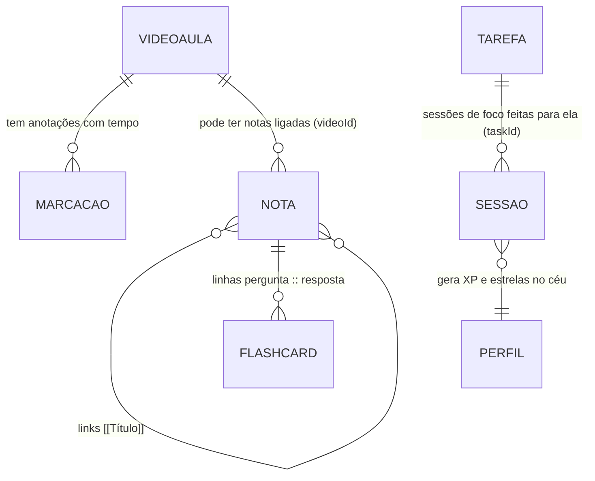

- Uma **nota** pode apontar para uma **videoaula** (`videoId`). Cada aula tem uma "nota da aula" (`lesson`), criada quando você escreve a primeira coisa. Os tempos ▶ 12:34 dentro dela abrem o vídeo naquele segundo.
- As **notas se ligam entre si** por links `[[Título]]` (no texto simples) / chips ↗ (no editor), sem tabela extra. O app procura essas menções para montar o "Mencionada em".
- **Pasta** (nota), **curso** (vídeo) e **matéria** (tarefa) são campos de texto livre que se sugerem entre si. Assim "Física" aparece igual nos três.
- Uma **sessão de foco** pode registrar para qual **tarefa** você estava estudando.
- Os **flashcards** saem das notas: o app lê as linhas `pergunta :: resposta` e guarda só o progresso de cada uma (caixa e próxima data).
- **Sequência, céu e missões** são calculados a partir das sessões. Só os escudos usados (`frozen`) e as missões sorteadas do dia são guardados.
- O **XP** não é guardado por item: o perfil acumula pontos, e o nível e a coleção são *calculados* a partir do total.

---

## 5. Telas e fluxos

Navegação: **menu fixo embaixo** (Início · Notas · Aulas · Tarefas · Foco), **busca no topo** e o **perfil** (nível/configurações) no canto superior direito. O botão "voltar" do celular funciona normalmente.

### 📝 Anotar
```
Notas ─► [+ Nova nota] ─► digita título, pasta e texto (salva sozinho)
                               │
                               ├─ barra: H1 H2 B I U S 🖍️ • 1. ☑ 💡 🖼️ 🔗
                               ├─ digita / ─► menu de blocos (título, lista, citação, imagem…)
                               ├─ digita [[ ─► escolhe ou cria a nota ─► chip ↗ clicável
                               ├─ Ctrl+V num print ─► imagem na nota
                               └─ ✨ ─► resumir, flashcards, quiz, perguntar
Lista de notas: filtrar por 📁 pasta e por #tag
```
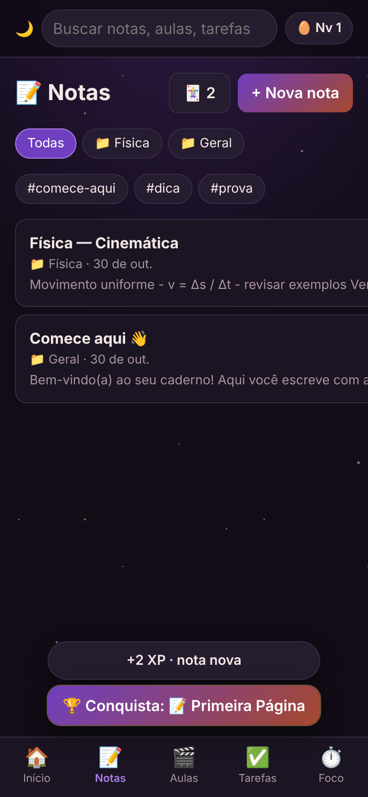 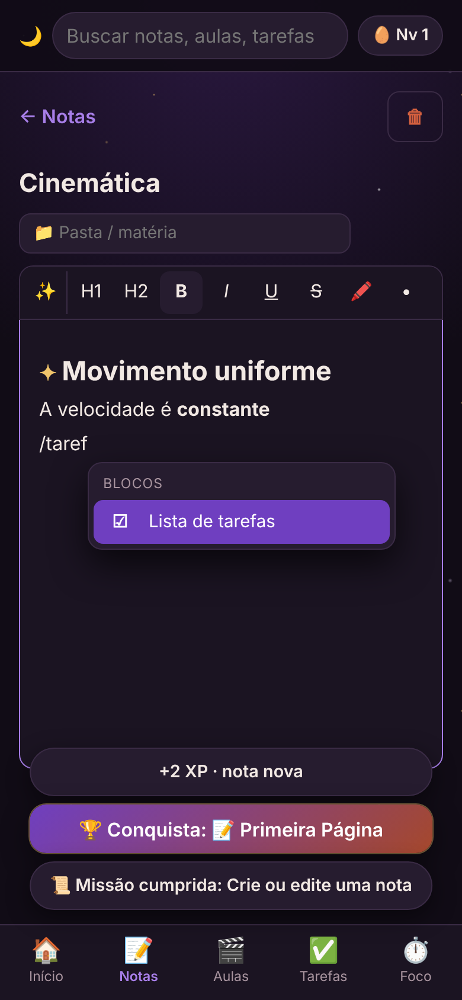 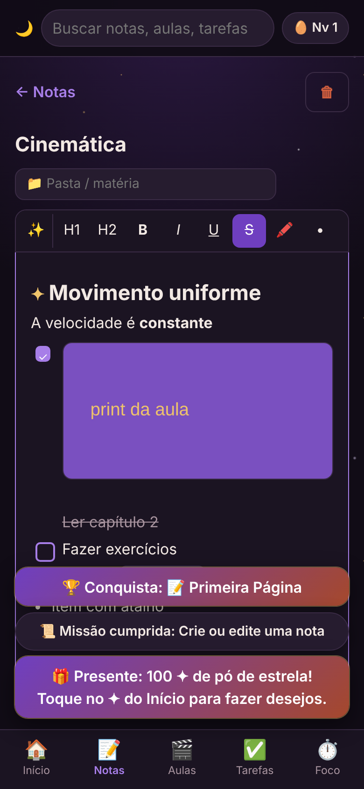

### 🎬 Assistir e acompanhar videoaulas
```
Aulas ─► [+ Adicionar aula] ─► cola link do YouTube + curso
  │
  └─► abre a aula ─► vídeo começa de onde você parou
         │
         ├─ aba 📝 Anotações: escreve à vontade, o vídeo CONTINUA tocando
         │     └─ botão ⏱ ─► insere ▶ 12:34 (o tempo atual) no texto
         ├─ aba ⏱ Marcações: marca momentos rápidos (pausar é opcional)
         ├─ clica em ▶ 12:34 ─► vídeo pula para aquele trecho
         ├─ 📌 ─► vídeo fixo no topo enquanto você rola e escreve
         └─ passou de 90% ─► ✓ concluída (+20 XP)
```


### ✅ Gerenciar tarefas
```
Tarefas ─► [+ Nova tarefa] ─► título, prazo, matéria, coluna
   │
   ├─ celular: botões ◀ ▶ movem entre colunas
   ├─ computador: arrastar e soltar
   ├─ chegou em "Concluído" ─► +10 XP
   └─ toque no cartão ─► editar ou excluir
Cartões com prazo hoje ficam laranja e os atrasados vermelhos. As próximas aparecem no Início.
```


### ⏱️ Foco e 🏠 Início
O **Início** foi pensado para quem tem dificuldade de começar: o botão principal já inicia um Pomodoro e o **"Só 5 minutinhos"** reduz a barreira. A **pausa** convida a dar uma olhadinha no celular, então o doomscroll vira recompensa em vez de fuga.

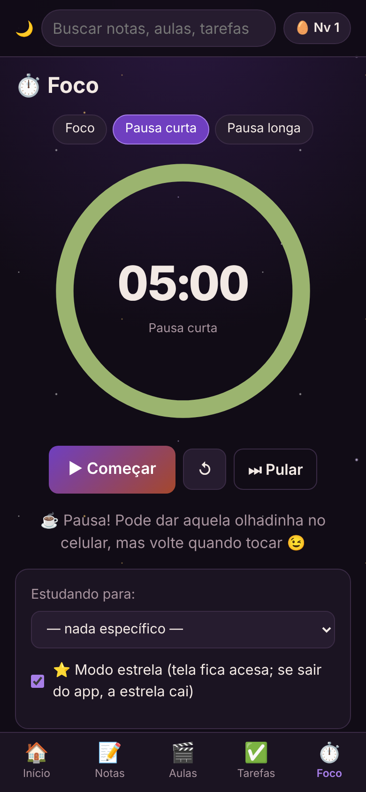 

---

## 🌟 Mecânicas para criar o hábito (v1.2)

Cada uma foi inspirada num app que funciona para muita gente e adaptada para estudo:

| Inspiração | Mecânica no EstudoQuest | Por que ajuda |
|---|---|---|
| **Forest** | ⭐ **Modo estrela**: durante o Pomodoro uma estrela cresce (✧ → ✦ → ⭐ → 🌟). Se você sair do app por mais de 10 s, ela cai 💫. As estrelas que chegam ao fim formam o **seu céu** no Perfil, e sessões longas viram estrelas maiores. A tela fica acesa sozinha. | Transforma "não pegar o celular" num objetivo visível. A sessão continua valendo mesmo se a estrela cair: o app não te pune, só deixa de te dar o bônus. |
| **Duolingo** | 🎯 **Meta mínima do dia** (padrão: 5 min). 🔥 Sequência de dias. 🛡️ **Escudos**: a cada 5 dias seguidos você ganha um (até 2), e ele salva sua sequência se você perder um dia. | Hábito é sobre não falhar, não sobre quantidade. O escudo evita o "quebrei a sequência, desisto". |
| **Duolingo / Habitica** | 📜 **3 missões diárias** sorteadas (1 de foco + 2 variadas). Completar as três dá +30 XP. | Você já abre o app sabendo qual é o próximo passo. |
| **Calendário do GitHub** | 📅 **Calendário de constância** (14 semanas) no Perfil e **semana** no Início. | Ver a corrente crescer dá vontade de não quebrá-la. |
| **Focusmate / Session** | ✍️ **Intenção** antes ("Nesta sessão eu vou…") e **avaliação** depois ("Como foi? 😀😐😞"). | Uma meta clara e pequena por sessão. Com o tempo, você descobre seus melhores horários. |
| **Técnicas para TDAH** | 🧘 **Modo imersão**: durante o foco o menu some, ficando só o timer, a intenção e a estrela. 💭 **Estacionamento de distrações**: anota a distração em 2 s e volta. Na pausa, cada item vira tarefa ou é descartado. | Adia a distração em vez de lutar contra ela. Ótimo contra o impulso do doomscroll. |
| **Anki** | 🃏 **Flashcards com repetição espaçada**: qualquer linha `pergunta :: resposta` numa nota vira cartão. Acertou, ele volta em 1, 2, 4, 8, 16, 32 dias; errou, volta para o fim da fila de hoje. | Revisar pouco e sempre fixa a matéria para a prova. |
| **"Quando… então…"** | 📌 **Plano** fixo no Início: "Quando eu terminar de jantar, eu vou fazer 1 Pomodoro de Física". | Ligar o estudo a algo que você já faz é o jeito mais confiável de começar sem força de vontade. |

   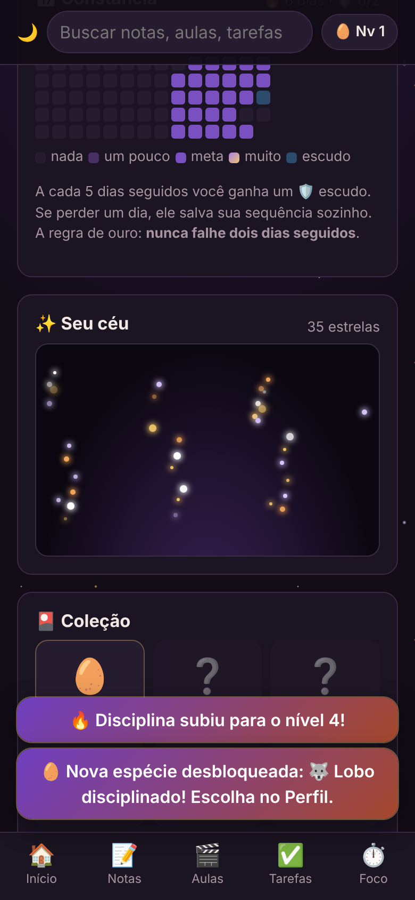

**Dicas fora do app que fazem diferença:**
- Ative o **Modo Foco** do celular durante o Pomodoro (Android: Bem-estar digital; iPhone: Ajustes → Foco). O app não consegue bloquear outros apps sozinho.
- Crie um **alarme** no horário do seu plano com o nome "📚 EstudoQuest".
- Coloque o ícone do app na **primeira tela** do celular, no lugar de uma rede social.

---

## 🧪 Laboratório de experimentos (v1.11)

Fase 6, a última do modo RPG. Em 🌳 Árvores → 🧪 Lab, ou no botão "🧪 Experimento prático" de cada conceito:

- **Casos práticos:** a IA monta um **cenário realista com dados** (ex.: "Dona Ana importa café e quer definir o preço de venda") usando as suas notas como base. Você resolve **com suas palavras, mostrando o raciocínio**.
- **Três níveis:** 🌱 Aprendiz, ⚗️ Praticante e 🔥 Mestre. O padrão segue o estágio do conceito (descoberto → Aprendiz, praticado → Praticante, dominado → Mestre).
- **💡 Dicas em escada:** 3 dicas, da mais leve à mais específica. Não tiram nada.
- **Retorno construtivo:** ✅ o que você acertou, 🔧 o que melhorar e uma nota com **crédito parcial** (o raciocínio conta, não só o número final). A **resolução completa** e os **🔀 outros caminhos** ficam fechados até você querer ver, para dar chance de revisar antes.
- **✍️ Revise e reenvie** quantas vezes quiser: vale a melhor nota, e o rascunho fica salvo se você sair da tela. O prêmio vem uma vez por faixa (parcial e resolvido).
- **🃏 O que faltou vira flashcard** com um toque, e dá para **📝 salvar** o caso e a resolução na nota do conceito.
- **Conta como aprendizado de verdade:** um experimento com 60% ou mais conta como prática do conceito. Com 80% ou mais, ele **substitui o quiz** na exigência do 👑 Dominado. A revisão espaçada dos flashcards continua obrigatória, então novos cards do que você errou também precisam ser revisados. Experimentos resolvidos somam no atributo 👑 Maestria.

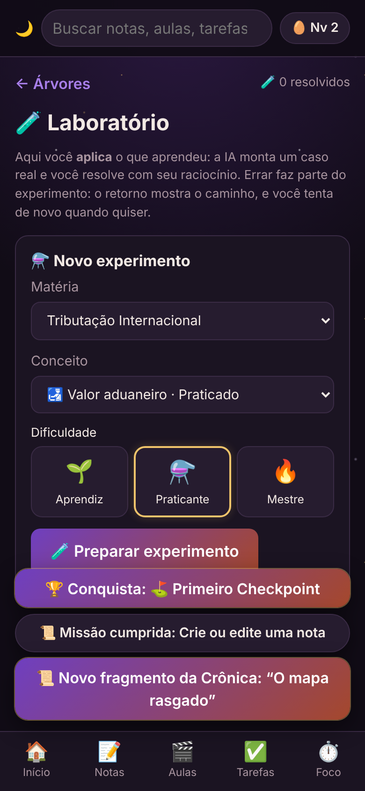 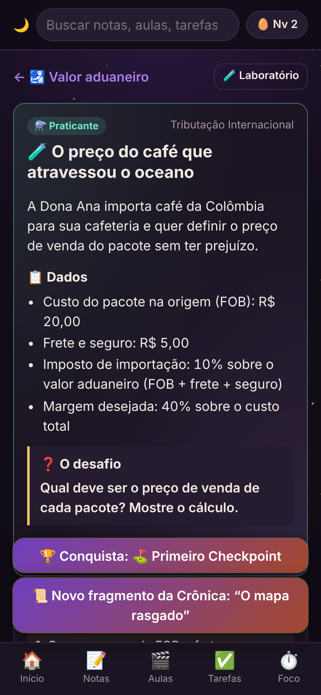 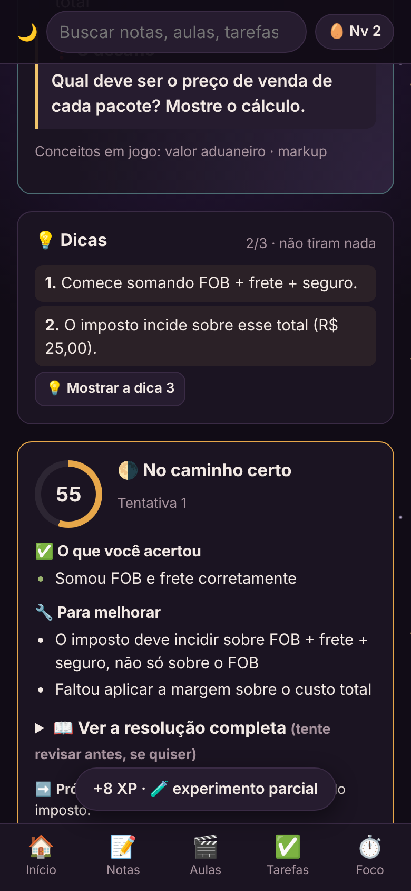 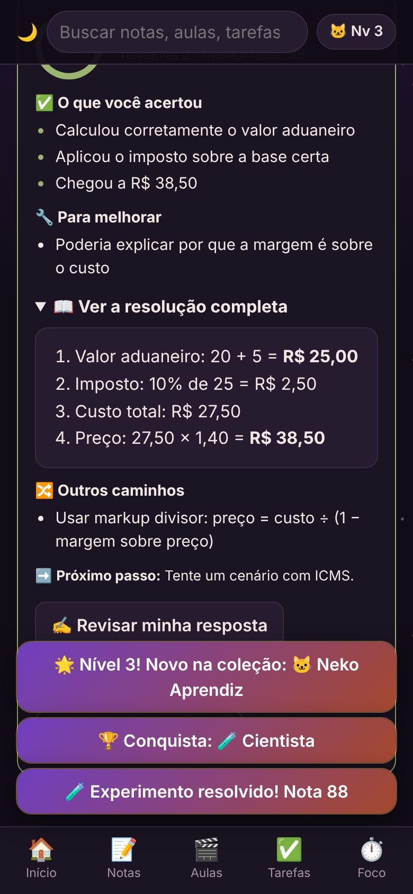

---

## 🔮 Matérias, cursos e descobertas (v1.10)

**Matérias e cursos**
- Cada aula pertence a uma **matéria**, e a matéria pode pertencer a um **curso** opcional (ex.: "MBA Comércio Exterior"). Em 🎬 Aulas, tudo aparece agrupado: 🎓 curso → 📚 matéria → aulas.
- O ✏️ ao lado da matéria **renomeia em todo o app** (aulas, notas, tarefas, árvore, campanha e minutos estudados) e escolhe o curso.
- No ⏱️ Foco, "📚 Estudando qual matéria?" lista suas matérias (ou crie uma nova). Abrir uma aula já deixa a matéria dela escolhida para o próximo Pomodoro.
- Em Perfil → 📊 Sua semana, aparecem os **minutos por matéria** (esta semana e no total), para você ver o que estudou mais.

**🔮 Mistério da aula** (fase 5 do modo RPG; ideia da usuária)
- Na página da aula, "Criar o mistério": a IA assiste **um trecho de ~8 minutos escolhido ao acaso** e esconde ali uma pergunta sobre um detalhe (um número, um exemplo, uma definição). Você não sabe em que parte está, então precisa **assistir à aula para descobrir**. Usar só um trecho gasta bem menos do limite grátis do que a aula inteira.
- Responda **com suas palavras**: a IA corrige pelo sentido, aceitando outras palavras e erros de digitação. Errou? Recebe um comentário gentil (sem a resposta) e pode pedir uma 💡 dica.
- **Sem punição:** dá para revelar a resposta depois de ver 90% da aula ou de 3 tentativas. Só não ganha o prêmio.
- Resolver dá XP e ✦ (até 3 mistérios por aula) e mostra o ▶ momento exato em que a resposta aparece.

**📜 Crônica de Lumi e 🏺 relíquias**
- Uma história em 10 fragmentos que se revelam com marcos de aprendizado: mistérios resolvidos, conceitos dominados, checkpoints, revisões em dias diferentes. Fica no Perfil → 📜 Crônica.
- **Relíquias** são enfeites que **não saem nos Desejos**, só com esses marcos: 🔍 Lupa de detetive, o título "Detetive das Aulas", o tema "Biblioteca Ancestral" e o título "Guardião(ã) da Crônica".

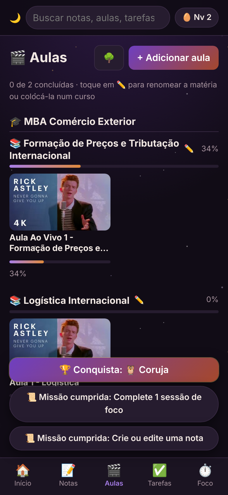 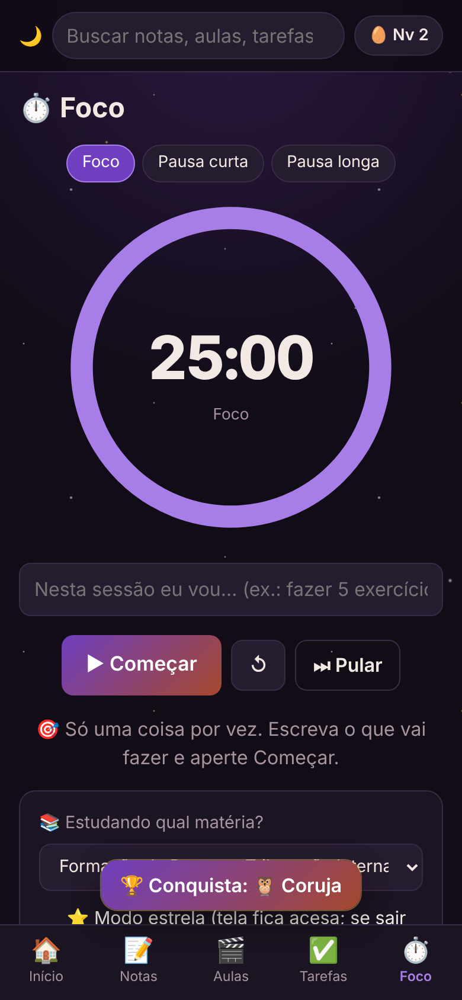 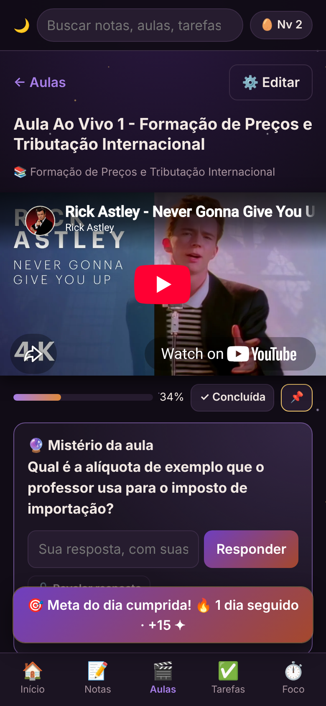 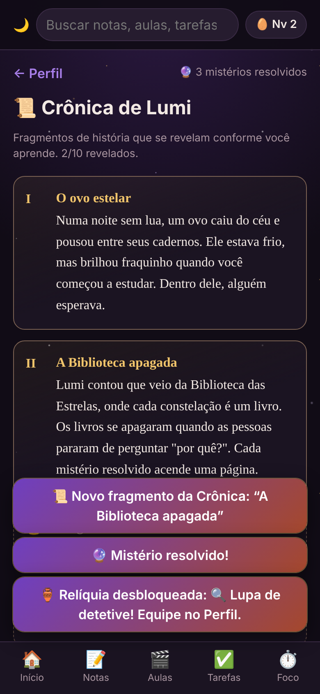

---

## 🗺️ Modo campanha (v1.9)

Fase 4 do modo RPG. Cada matéria com árvore ganha uma **campanha** (aba 🗺️ Campanha, ao lado de 🌳 Árvore):

- **📖 Capítulos:** os "andares" da árvore. Conceitos sem pré-requisito ficam no capítulo 1, os que dependem deles no 2, e assim por diante. Dá para **renomear** cada capítulo (✏️).
- **⛳ Checkpoints:** um capítulo é concluído quando todos os conceitos dele chegam a 🛠️ Praticado. Cada checkpoint dá XP e ✦ uma única vez, e o marcador ganha um "carimbo" animado na próxima visita.
- **📍 Você está aqui:** o capítulo atual mostra as **missões do capítulo** (o próximo passo de cada conceito). Os capítulos à frente aparecem "na névoa", mas **nada fica trancado**: dá para estudar fora de ordem.
- **📜 Missões secundárias:** as tarefas do quadro marcadas com a matéria aparecem na campanha, e dá para concluí-las ali mesmo.
- **🏰 Desafio final:** abre quando todos os capítulos chegam ao checkpoint. São 8 perguntas misturando a matéria inteira (com seus flashcards ou com a IA). Acertando 80%, a campanha é concluída e você ganha um **item épico ou lendário**. Errar não tira nada: tente quantas vezes quiser, e o app guarda seu melhor resultado.
- O progresso usa o maior estágio já conquistado de cada conceito, então a campanha **nunca regride**. Quem já tinha árvores recebe os checkpoints que já merecia.

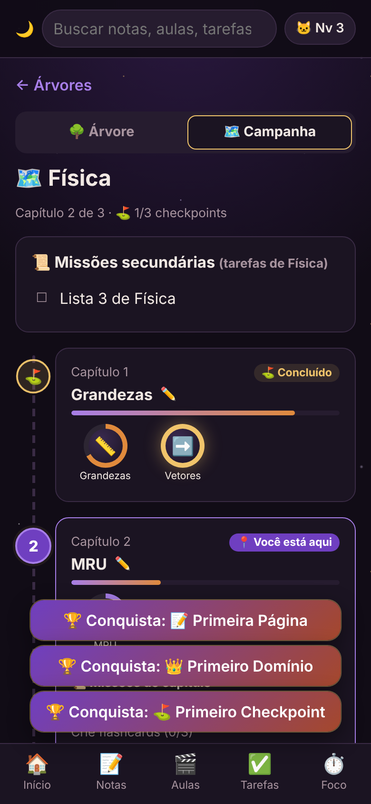 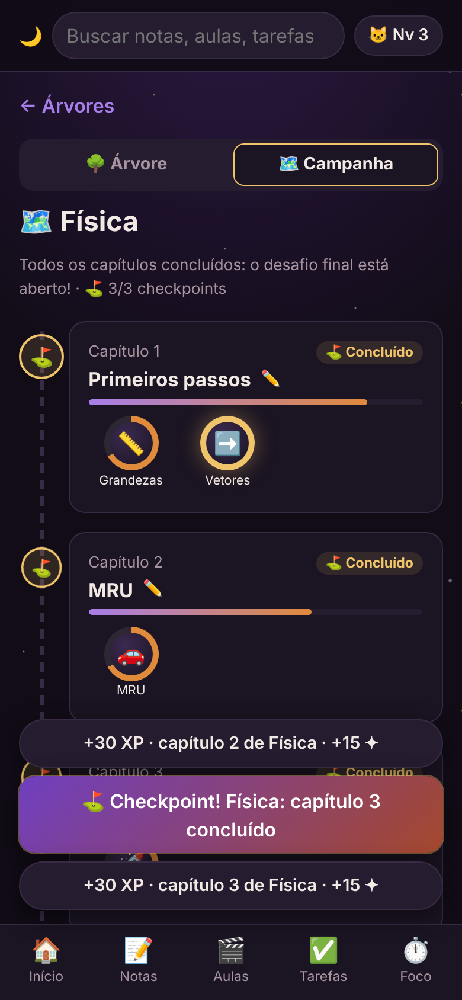 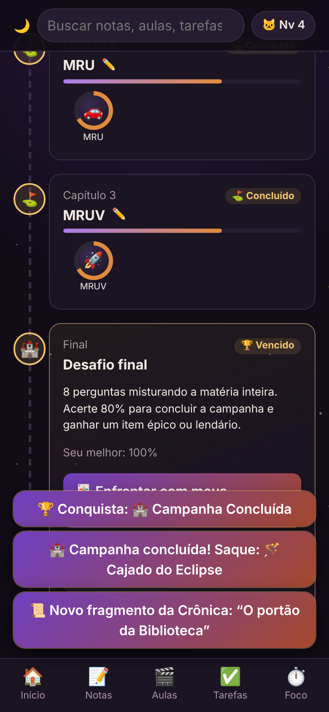

---

## ⚔️ Batalhas e equipamento (v1.8)

Fase 3 do modo RPG. O chefe da semana agora também pode ser **enfrentado com perguntas** (botão ⚔️ Enfrentar no Início ou na ficha):

- **🃏 Com seus flashcards** (grátis, funciona offline): múltipla escolha, com os cards difíceis primeiro. **Cada card luta uma vez por dia**, para a batalha não virar decoreba.
- **✨ Com a IA**: perguntas novas criadas a partir das suas notas da matéria.
- **Acerto = dano** no chefe (somado ao dano dos minutos de foco). Acertos seguidos fazem **combo**.
- **Errar não tira nada:** você vê a resposta (com link para a nota), e o card **volta para a revisão de hoje**, para praticar.
- **Recompensas:** XP, ✦ e **um item** por batalha (até 3 por dia; acertar mais dá itens melhores). Derrotar o chefe dá **item raro ou melhor garantido**.

**Equipamento (estilo Diablo):** três espaços, ⚔️ Arma (dano base), 🛡️ Proteção (combo e proteção contra erros) e 💍 Amuleto (✦, XP e afinidade com matérias). Os itens têm raridade (comum, raro, épico, lendário), bônus aleatórios (como "+19% de dano em Física", "+53% de dano em cards difíceis" ou "protege o combo de 1 erro") e os **lendários têm poderes únicos** (Fênix, Erudito, Eclipse).

**O equipamento não aumenta seus atributos.** Eles medem o que você aprendeu de verdade. É ao contrário: **cada item escala com um atributo real**. Um Grimório bate mais forte quanto maior o seu 📚 Conhecimento, uma Katana com 🔥 Disciplina, um Cajado com 👑 Maestria. Itens que você não quer viram ✦ ao desmontar, no 🎒 Arsenal.

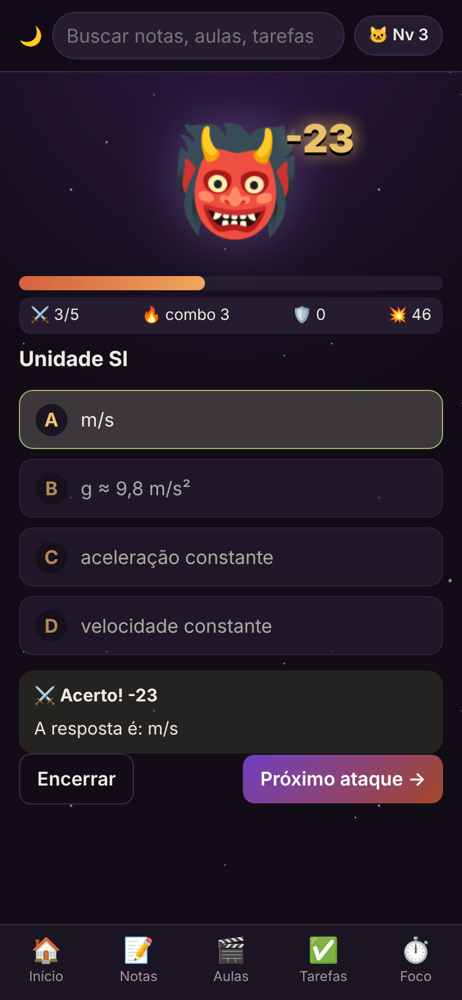 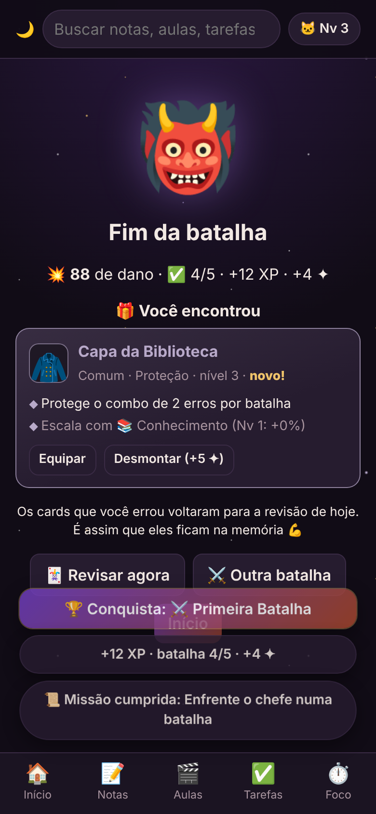 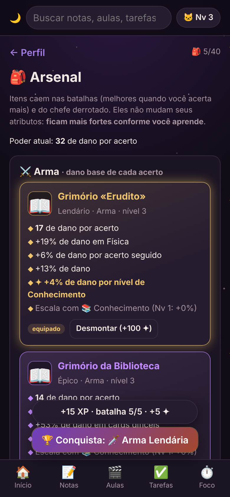 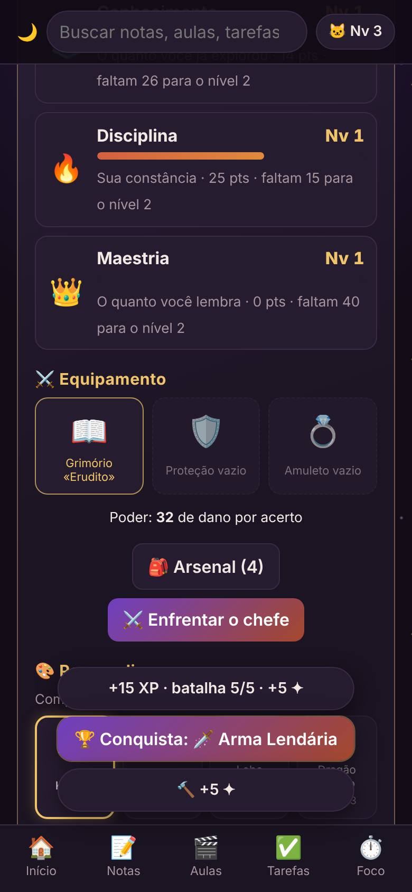

---

## 🧙 Ficha do personagem (v1.7)

Fase 2 do modo RPG. No topo do **Perfil** aparece a ficha do seu personagem:

- **Seu companheiro** (toque para mudar o nome), o **nível**, o **título** e uma **classe** que muda conforme seu atributo mais forte: 🦉 Sábio(a) Explorador(a), 🥋 Monge da Disciplina, 🔮 Arcano(a) da Memória ou ⚖️ Aventureiro(a) Equilibrado(a).
- **Três atributos**, calculados do que você realmente fez (toque em cada um para ver de onde vem cada ponto):

| Atributo | Pontos vêm de |
|---|---|
| 📚 **Conhecimento** | conceitos descobertos na árvore, flashcards criados, aulas concluídas, notas com conteúdo |
| 🔥 **Disciplina** | minutos de foco, dias com a meta cumprida, chefes derrotados, dias com todas as missões |
| 👑 **Maestria** | conceitos praticados e dominados, acertos em flashcards, acertos em quizzes |

- **Só sobem:** o maior valor fica guardado. Apagar uma nota ou esquecer um card não tira pontos.
- **Personalizar:** escolha a **espécie** do companheiro (🦊 Kitsune, 🦉 Coruja sábia, 🐺 Lobo disciplinado, 🐉 Dragão arcano), o **acessório**, o **tema de cor** e o **título** que você ganhou nos Desejos. As três espécies novas **se desbloqueiam aprendendo**: cada uma pede o nível 3 de um atributo.
- Quem já usava o app começa com os atributos calculados do histórico. Há 3 conquistas novas.

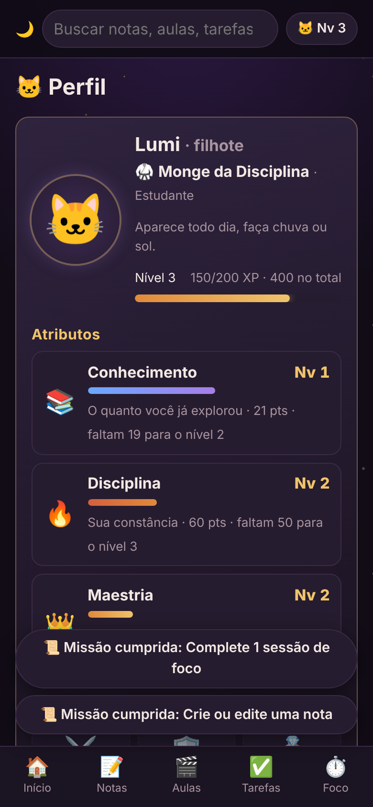 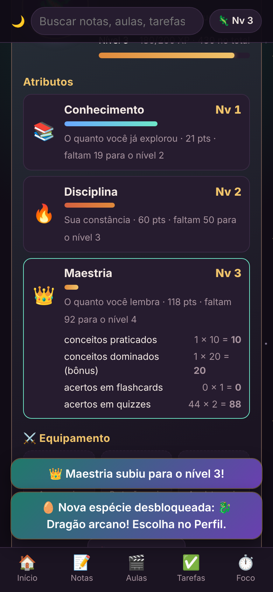 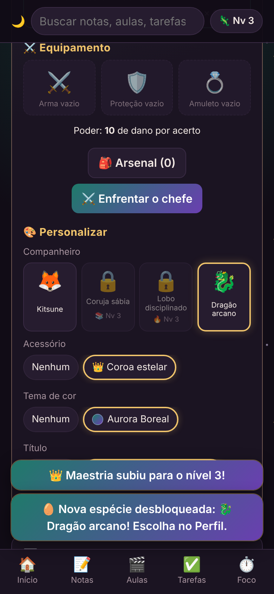

---

## 🌳 Árvores de conhecimento (v1.6)

Primeira fase da evolução para um RPG de aprendizado (plano completo em [`docs/RPG-ROADMAP.md`](docs/RPG-ROADMAP.md)). Cada matéria (a mesma pasta das notas e curso das aulas) vira uma **árvore de conceitos**, e cada conceito sobe de estágio **só com provas de aprendizado**:

| Estágio | Como conquistar |
|---|---|
| 🔍 **Descoberto** | Assistir a ≥ 10% de uma aula ligada, ou escrever na nota ligada. |
| 🛠️ **Praticado** | Lembrar 3 flashcards corretamente, ou fazer ≥ 60% num quiz. |
| 👑 **Dominado** | Ter ≥ 3 flashcards, 80% deles lembrados **em 2 dias diferentes** (revisão espaçada) **e** passar no desafio do conceito com ≥ 80% (ou lembrar em 3 dias diferentes). |

- **Montar a árvore:** em 🌳 (Notas ou Aulas) → escolha a matéria → "Montar com minhas aulas e notas" (as aulas viram uma trilha em ordem) ou "✨ Sugerir um mapa de conceitos com IA" (a IA descobre quais conceitos dependem de quais). Depois, ✏️ Editar liga notas, aulas e pré-requisitos (o app impede ciclos).
- **Tudo se conecta:** as anotações das aulas ligadas contam sozinhas. Os quizzes feitos na aula, na nota ou no ⚔️ desafio do conceito também contam, incluindo quizzes antigos. Os flashcards da nota alimentam o domínio.
- **Por conceito:** "O que fazer agora" mostra a próxima ação útil, uma checklist mostra os números reais de cada estágio, há revisão só dos cards **vencidos** daquele conceito (não dá para pular o espaçamento) e flashcards criados com IA a partir das **suas** notas/aula.
- **Sem punição:** o maior estágio conquistado fica guardado. Se um card for esquecido, aparece só um aviso gentil de revisão.
- **No resto do app:** chips 🌳 nas páginas de aula e nota, **uma** linha de "Próximo passo" no Início, XP e ✦ ao subir de estágio, 3 conquistas e uma missão diária.
- **Acessível:** o estágio aparece em ícone e texto (não só cor), os nós são links com descrição completa para leitor de tela, e as animações desligam com "reduzir movimento".

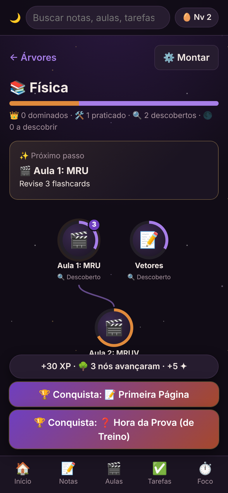 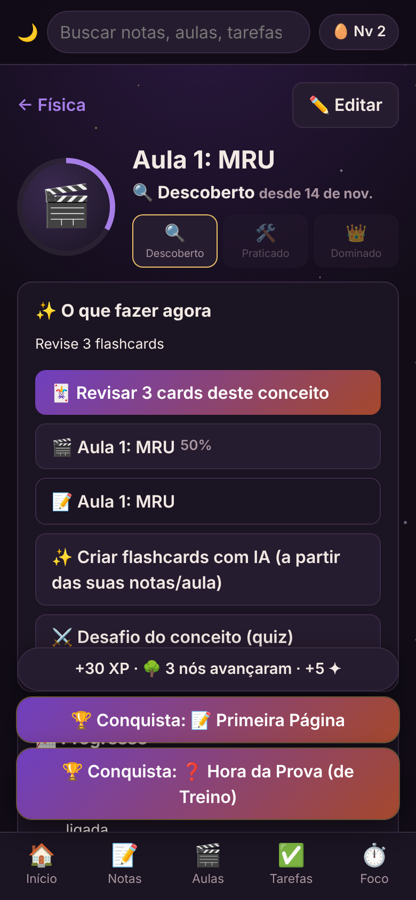 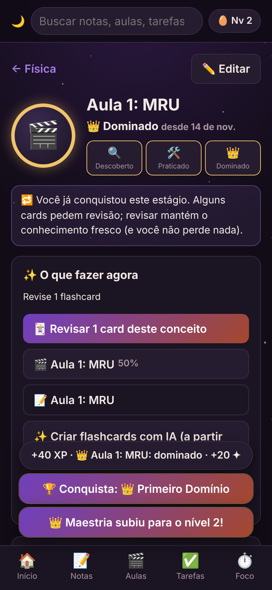 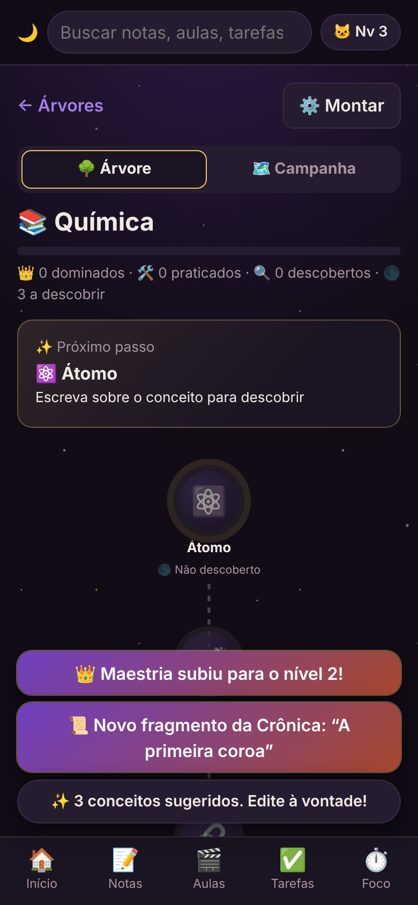

---

## 🎬✨ IA que assiste suas videoaulas (v1.5)

O Gemini consegue **assistir vídeos públicos do YouTube direto pelo link**, sem precisar de legenda. Na página da aula há uma aba **✨ IA** com:

| Botão | O que faz |
|---|---|
| 📝 **Resumo com tempos** | Resumo em tópicos; cada tópico tem um ▶ 12:34 clicável que pula o vídeo para aquele trecho. |
| 🗺️ **Mapa de tópicos** | Os "capítulos" da aula com o momento de cada um. Ótimo para achar a parte que você não entendeu. |
| 🃏 **Flashcards da aula** | Cartões `pergunta :: resposta` que entram direto na sua revisão espaçada. |
| ❓ **Quiz da aula** | Quiz **interativo**, uma pergunta por vez, com explicação. Quando você erra, aparece **"▶ Rever em 03:40"**, que leva ao trecho do vídeo que explica aquilo. Cada acerto vale XP e ✦ (gabaritar dá bônus), e no fim **os erros viram flashcards** com um toque. |
| **Pergunte sobre a aula** | Tire dúvidas como se fosse com um monitor que viu a aula com você. |

- **"A IA deve ver"**: a aula inteira, **só até onde você assistiu** (sem spoilers e gastando menos do limite) ou só os últimos 10 minutos.
- A IA também lê as **suas anotações da aula**, para a resposta conversar com o que você já escreveu.
- Resumo e mapa ficam **guardados**: abrir de novo não gasta seu limite (dá para pedir "🔄 Gerar de novo").
- O **quiz interativo** também funciona nas notas: ✨ → ❓ Quiz interativo.
- Nova missão diária "Faça um quiz com a IA" e duas conquistas novas (❓ e 💯).

**Limites e cuidados:** só vídeos **públicos** (privados ou "não listados" não funcionam). No plano grátis, até **~8 horas de vídeo por dia**. Esse recurso do Google ainda está em teste, então limites e regras podem mudar. Vídeos que não são do YouTube (link .mp4) usam só as suas anotações.

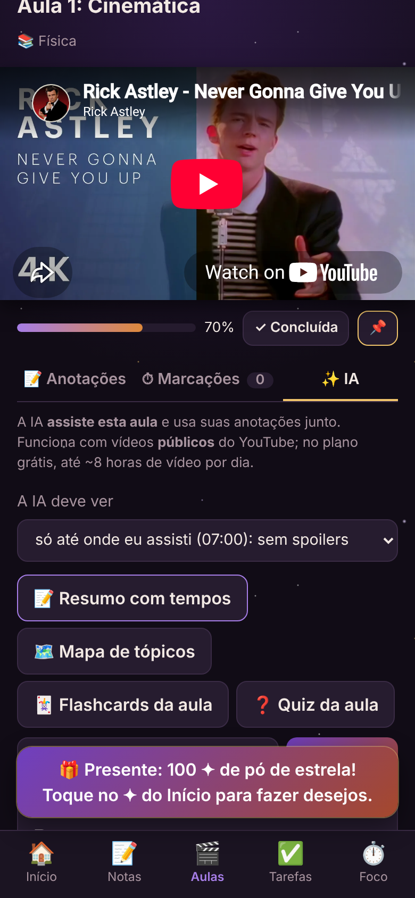 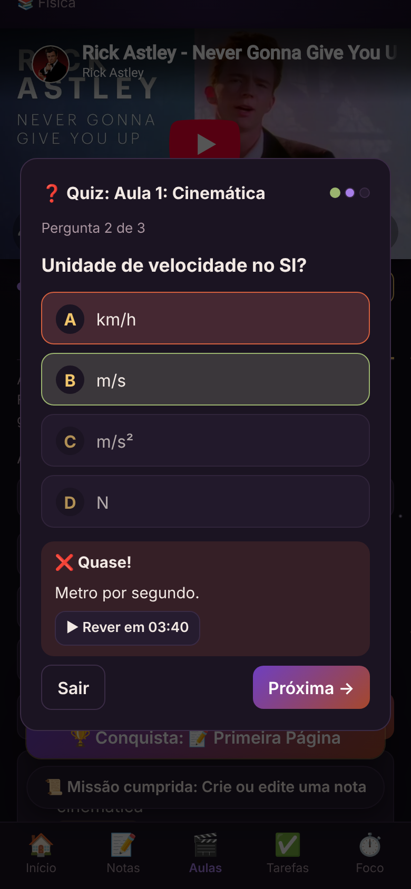 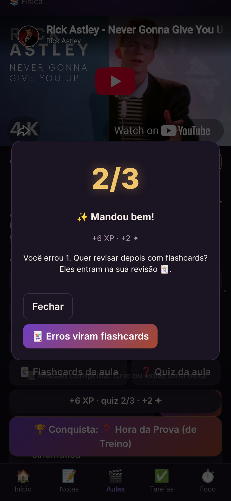

---

## 🦊 Mais jogo e mais hábito (v1.4)

Inspirado no **Finch** (mascote que cresce com você), no **Habitica** (chefes), no **YPT** (comparar seu tempo de estudo) e em jogos gacha. A regra foi: **só se ganha recompensa estudando**, e nada exige "cuidar" do jogo. As análises desses apps alertam que, quando o jogo vira o passatempo, o estudo fica de lado.

| Novidade | Como funciona |
|---|---|
| 🦊 **Mascote Lumi** | Aparece no Início e **evolui com seu nível**: ovo → filhote → kitsune → kitsune de nove caudas, com aura. **Reage ao seu dia**: sonolento antes de estudar, animado no meio, pulando quando você bate a meta. Toque nele para trocar o nome. |
| ✦ **Pó de estrela** | Ganho estudando: 25 min de foco = 10 ✦ (+2 com estrela), meta do dia = 15 ✦, 3 missões = 20 ✦, chefe = 80 ✦. Quem atualizou ganha 100 ✦ de presente. |
| 🌠 **Desejo das Estrelas** | Gacha **só de enfeites**: temas de cor para o app, acessórios para o mascote (🎀 🧣 👓 🎩 🪄 👑…) e títulos. Chances visíveis (comum 60%, raro 30%, épico 9%, lendário 1%), **raro garantido a cada 10 desejos** e item repetido devolve ✦. Toque no ✦ do Início. |
| 🐉 **Chefe da semana** | Um chefe novo toda segunda (Dragão da Procrastinação, Kraken do Doomscroll…). Cada minuto de foco é 1 de dano. Derrote até domingo para ganhar 80 ✦. A vida dele é ajustável no Perfil (padrão: 150 min/semana). |
| 👻 **Rival fantasma** | "Você da semana passada": compara seus minutos até agora com os da semana anterior no mesmo ponto. É uma competição sem precisar de amigos nem servidor. |
| 🎧 **Sons de foco** | Chuva, ruído marrom ou ruído rosa, **gerados pelo próprio navegador** (sem arquivos, funciona offline). Tocam só durante o foco. Escolha na tela Foco. |
| 📅 **Provas** | Contagem regressiva no Início ("12 dias · Prova de Física"). Fica vermelha a 3 dias. |
| 🔔 **Lembrete diário** | No plano 📌, escolha o horário e toque em "Adicionar lembrete diário ao calendário". Baixa um arquivo que o celular abre no app de calendário, e ele passa a avisar **todo dia, mesmo com o EstudoQuest fechado**. Sem servidor e sem custo. |
| 📊 **Sua semana** | Gráfico de minutos por dia no Perfil, comparação com a semana passada e quantas sessões foram 😀. |

 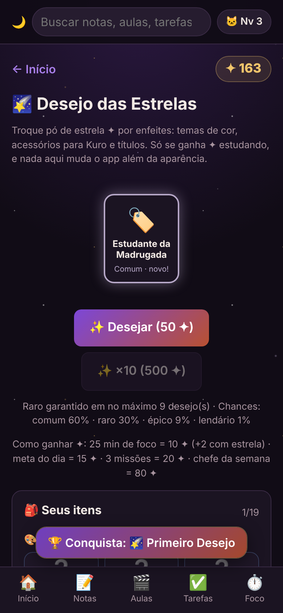 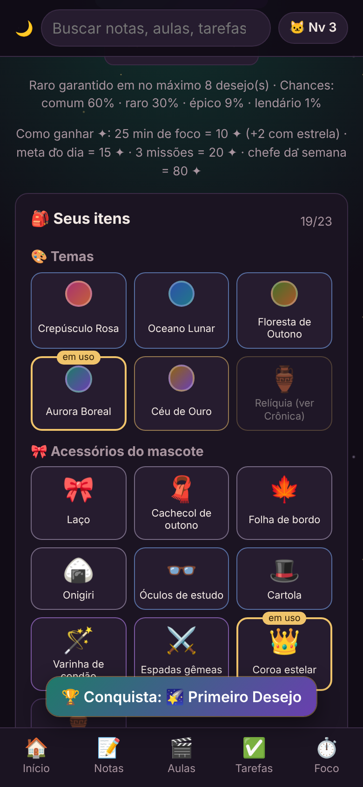 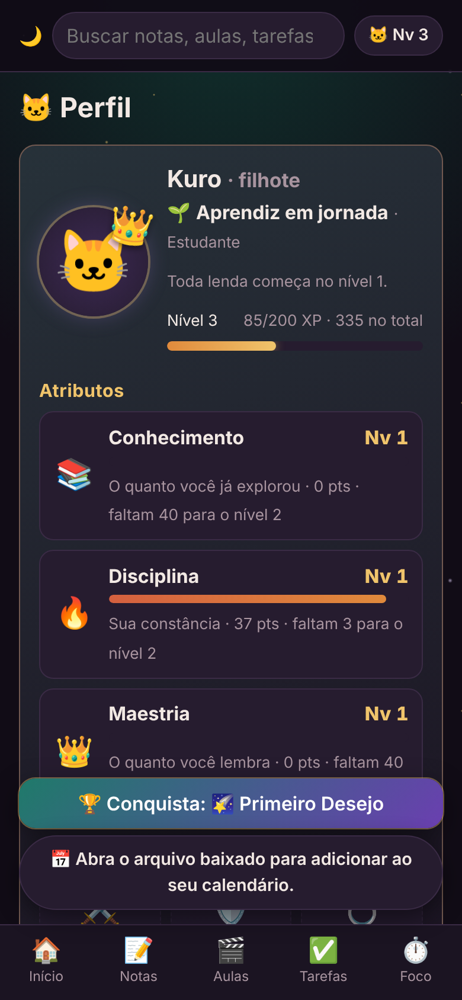

---

## ✍️ Editor de notas, aulas e IA (v1.3)

### Editor estilo Notion (sem Markdown)
- **Barra de ferramentas** fixa no topo da nota: ✨ IA, títulos (H1/H2), **negrito**, *itálico*, sublinhado, riscado, 🖍️ marca-texto, listas (•, 1., ☑ tarefas), 💡 destaque, 🖼️ imagem, 🔗 link para nota, `/` mais blocos, desfazer/refazer.
- **Menu `/`**: numa linha, digite `/` e escolha o bloco. Dá para filtrar digitando, por exemplo `/tare` para lista de tarefas.
- **Links entre notas**: digite `[[` e escolha a nota (ou crie uma nova). Vira um chip ↗ que abre a nota.
- **Prints e imagens**: cole com **Ctrl+V** (no computador: `Win+Shift+S` ou `Cmd+Shift+4` para tirar o print, depois Ctrl+V), arraste o arquivo ou use 🖼️, que no celular abre a galeria ou a câmera.
- **Atalhos opcionais** para quem já conhece: `# ` vira título, `- ` vira lista, `[] ` vira caixinha, `> ` vira citação, `--- ` vira divisor.
- **Flashcards** continuam iguais: uma linha `pergunta :: resposta` vira cartão em 🃏 Revisar.
- Notas antigas, escritas em Markdown, foram convertidas automaticamente.

### Anotar enquanto assiste
Na página da aula há duas abas:
- **📝 Anotações**: um editor completo (o mesmo das notas) **sem pausar o vídeo**. O botão **⏱** coloca o momento atual do vídeo no texto como ▶ 12:34; tocar nele volta o vídeo para aquele ponto. O 📌 deixa o vídeo fixo no topo enquanto você rola. No computador, vídeo e anotações ficam lado a lado.
- **⏱ Marcações**: marcações rápidas de momentos. Pausar ao digitar agora é opcional e vem desligado. O botão "Copiar marcações para as anotações" leva todas para a aba 📝.

### ✨ Assistente de IA (grátis)
Usa o **Gemini**, do Google, que tem plano gratuito. O Claude não tem plano grátis, por isso não foi usado aqui.
1. Abra **[aistudio.google.com/apikey](https://aistudio.google.com/apikey)**, entre com sua conta Google e toque em **Create API key**.
2. No app, toque em ✨ em qualquer nota e cole a chave (ou vá em Perfil → Assistente IA).
3. Use **Resumir**, **Criar flashcards** (eles entram direto na sua revisão 🃏), **Fazer um quiz**, **Explicar simples** ou faça uma pergunta. **Inserir na nota** coloca a resposta no fim da nota.

Limites grátis aproximados (o Google muda de tempos em tempos; confira em AI Studio → Rate limits): **Gemini 3.5 Flash-Lite**, o padrão, faz ~500 pedidos por dia. O **Gemini Flash** é mais caprichado, mas faz só ~20 por dia. Dá para trocar em Perfil.

**Privacidade:** a chave fica só no aparelho e **não vai no backup**. O texto da nota é enviado ao Google quando você usa o ✨, e no plano grátis o Google pode usá-lo para melhorar os produtos dele. Não mande dados pessoais.

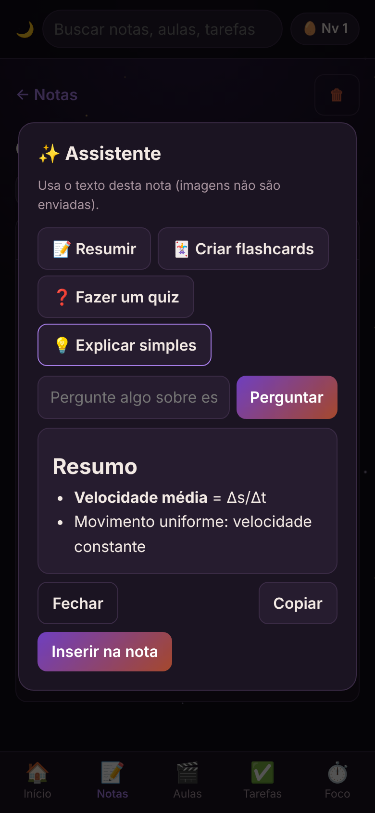

---

## 6. Como personalizar (procure por `✏️ PERSONALIZE` no código)

| Quero mudar… | Onde |
|---|---|
| Quanto XP cada ação dá | `app.js` → `CONFIG.xp` |
| Velocidade de subir de nível | `app.js` → função `levelInfo` (números 100 e 50) |
| Itens da coleção (seus personagens favoritos!) | `app.js` → `CONFIG.collection` |
| Conquistas | `app.js` → lista `ACHIEVEMENTS` |
| Colunas do quadro (ex.: adicionar "Revisar") | `app.js` → `CONFIG.columns` |
| % para considerar a aula assistida | `app.js` → `CONFIG.videoDoneAt` |
| Tempos padrão do Pomodoro | tela Perfil, ou `defaultState()` → `settings` |
| Cores | `style.css` → topo (`--accent` roxo, `--accent2` abóbora, `--gold` estrelas, `--btn-from`/`--btn-to` botões) |
| Quantidade/brilho das estrelas | `style.css` → `body::before` e `body::after` |
| Frases motivacionais | `app.js` → `viewHome` e `viewFocus` |
| Missões diárias | `app.js` → lista `QUESTS` |
| Escudos (a cada quantos dias, máximo) | `app.js` → `CONFIG.shieldEvery` e `CONFIG.maxShields` |
| Tempo fora do app antes de a estrela cair | `app.js` → `CONFIG.starGraceSeconds` |
| Intervalos dos flashcards | `app.js` → `NEXT_DAYS` |
| Meta diária e Modo estrela | tela Perfil (ou Foco, para o Modo estrela) |
| Pó de estrela, custo e chances do Desejo | `game.js` → `GAME.stardust`, `GAME.wishCost`, `GAME.rarity` |
| Itens do Desejo (temas, acessórios, títulos) | `game.js` → `GAME.items` |
| Evolução e falas do mascote | `game.js` → `GAME.petStages` e `PET_LINES` |
| Chefes e títulos por nível | `game.js` → `GAME.bosses` e `GAME.ranks` |
| Botões da barra e blocos do menu `/` | `editor.js` → `TOOLBAR_ITEMS` e `SLASH_ITEMS` |
| Cor do marca-texto | `editor.js` → `MARK_COLOR` |
| Tamanho/qualidade das imagens salvas | `editor.js` → `IMG_MAX_WIDTH` e `IMG_QUALITY` |
| Botões e "jeito" do assistente de IA | `ai.js` → `AI_ACTIONS` e `AI_SYSTEM` |
| Regras de cada estágio da árvore | `skills.js` → `SKILL_RULES` |
| Níveis, prêmios e limites do laboratório | `lab.js` → `LAB` |
| Regras do mistério (tamanho do trecho, prêmios, quando revelar) | `discovery.js` → `MYSTERY` |
| Texto da Crônica e regras de desbloqueio | `discovery.js` → `CHRONICLE` |
| Relíquias | `discovery.js` → `RELICS` |
| Recompensas e regras da campanha (checkpoint, desafio final) | `campaign.js` → `CAMPAIGN` |
| Regras das batalhas (perguntas, dano, itens por dia) | `battle.js` → `BATTLE` |
| Tipos de item, bônus e poderes lendários | `battle.js` → `GEAR_BASES`, `AFFIXES`, `UNIQUES` |
| De onde vêm os pontos dos atributos | `character.js` → `ATTRS` |
| Espécies do companheiro e como desbloquear | `character.js` → `SPECIES` |
| Velocidade de subir nível de atributo | `character.js` → `attrLevel` (40 e 30) |
| Recompensas ao subir de estágio | `skills.js` → `SKILL_REWARDS` |
| Botões da aba ✨ IA das aulas | `ai.js` → `VIDEO_AI_ACTIONS` |
| Quantidade e estilo das perguntas do quiz | `ai.js` → `QUIZ_PROMPT` |
| XP e ✦ do quiz | `app.js` → `CONFIG.xp.quizCorrect`; `game.js` → `GAME.stardust.quizCorrect` / `quizPerfect` |
| Modelos de IA oferecidos | `ai.js` → `AI_MODELS` |

**Dica para editar com segurança:** antes de mexer, exporte um backup. Se a tela ficar em branco depois de uma mudança, aperte `F12` no navegador e abra a aba **Console**: ela mostra a linha do erro.

### ⚡ Otimizações (v1.1)
- O timer só "acorda" enquanto está rodando, uma vez por segundo, e não redesenha a tela com o app minimizado. Gasta menos bateria.
- O app abre na hora usando a cópia salva no aparelho e baixa a versão nova por trás.
- Enquanto o vídeo toca, o progresso só é salvo quando muda, e não a cada 2 segundos mesmo pausado.
- **Correção:** o texto digitado logo antes de fechar o app era perdido. Agora ele é gravado ao minimizar ou fechar.
- A barra do topo não usa mais efeito de desfoque, que deixava a rolagem pesada em celulares simples.
- Conexão com o YouTube aberta antes de precisar, no máximo 3 avisos na tela e listas de notas e links mais rápidas.

### Limitações conhecidas
- Os dados ficam só no aparelho em que você usa o app. Faça backup.
- O progresso do vídeo conta o ponto mais longe que você alcançou, então pular para o final conta como assistido.
- No iPhone, as notificações do timer só funcionam com o app instalado na tela inicial (iOS 16.4+). O som toca normalmente com o app aberto.
- **Modo estrela:** o app só sabe se a tela dele está visível, não o que você faz no celular. Por isso a tela fica acesa durante o foco: se ela apagasse, contaria como "saiu do app". No computador, trocar de aba também derruba a estrela; se você estuda por um PDF em outra aba, desligue o Modo estrela.
- Os lembretes ainda não chegam com o app fechado (veja a v2). Por enquanto use um alarme do celular.
- **Print direto do vídeo do YouTube não é possível:** o YouTube não deixa outros sites copiarem a imagem do player. Tire um print do celular ou do computador e cole/anexe na nota.
- Algumas ações do editor (transformar em lista, inserir link ou tempo) não entram no ↶ desfazer.
- Imagens não são enviadas para a IA, só o texto da nota.
- A busca do título automático do YouTube pode falhar em algumas redes. Nesse caso, edite o título na aula (⚙️ Editar).
